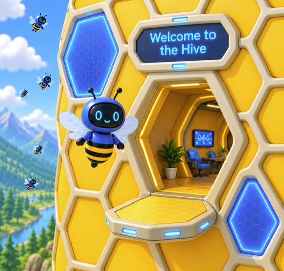
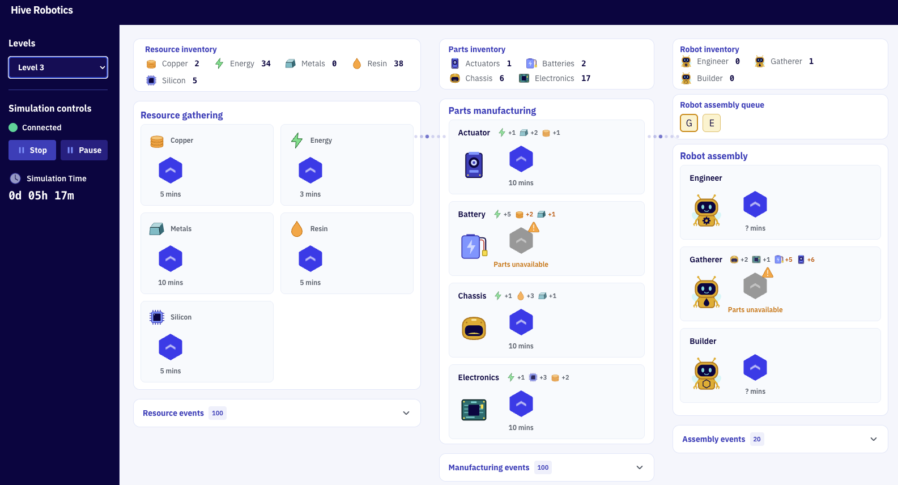
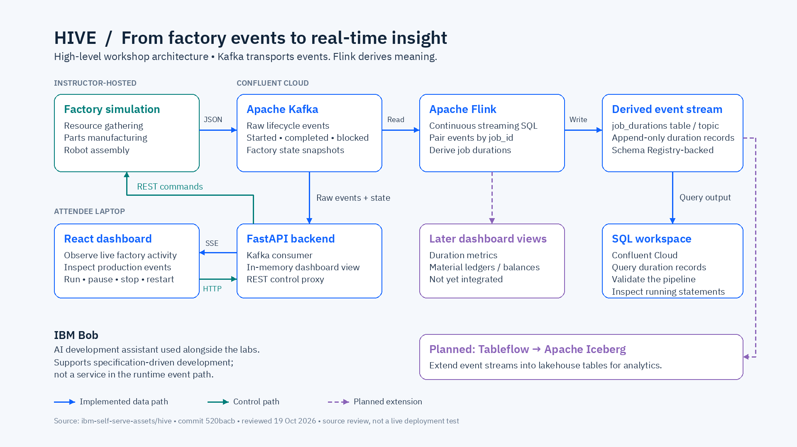

# Welcome to The Hive

**The Hive** is a hands-on workshop that expands on the familiar concept of **bee hives** to explore the powerful capabilities of event-driven architecture implemented with [Apache Kafka](https://www.confluent.io/resources/online-talk/getting-started-with-apache-kafka-r-and-real-time-data-streaming) and [Apache Flink](https://www.confluent.io/learn/apache-flink/) in [Confluent Cloud](https://confluent.cloud/).

A bee hive is a useful analogy for understanding event-driven systems because, at the Hive's core, is the **Queen bee**; controlling the Hive while also being isolated from the various workings within the Hive.  The **Queen** makes all decisions to keep the Hive functioning properly by listening to abstracted Events communicated to it through pheromones and tactile communication with its **worker bees**. Likewise the Hive itself is an vertically-integrated manufacturing facility (think SpaceX, Tesla, Rivian, ...) so there are enterprise use case analogies to be learned from understanding how Hives function.

## Workshop Levels
Head to **[Level 1 — Getting Started](level-1-getting-started/README.md)** to learn about your personal Hive simulation, configure your development environment and expore your Hive Dashboard.

| Level | Title | Focus |
|---|---|---|
| 1 | Environment Setup | Connect to Confluent Cloud, provision topics, launch the Hive Dashboard |
| 2 | Intro to Apache Flink | Interval joins → job duration stream (`workstation_efficiency`) |
| 3 | Hive Inventory | Stateful aggregations → live inventory balances (`resource_inventory`, `parts_inventory`) |
| 4 | Queen's Orders | Orders for new worker bees → live order queue (`queens_orders`), then join it with recipe inputs → parts manufacturing queue (`parts_priority_queue`) |
| 5 | Gamified UI *(planned)* | Play the Hive from a game-style dashboard |
| 6 | Tableflow *(planned)* | Materialize streams as Apache Iceberg tables |
| 7 | Headless Agent *(planned)* | Install IBM Bob in a headless agentic harness |
| 8 | Bob Runs the Hive *(planned)* | IBM Bob manages the Simulation end-to-end |

## Hive Architecture

The HIVE platform is built around an event-driven architecture connecting a hosted Simulation engine, cloud-native streaming data pipelines, and a local attendee dashboard:

1. **Simulation Server (Hosted Engine)**: Simulates the robotics manufacturing floor (gathering raw materials, fabricating parts, and assembling robots). It receives attendee lifecycle commands (Start, Pause, Stop, Restart) over HTTP REST and writes raw event logs directly to Confluent Cloud.
2. **Confluent Cloud (Event Streaming Backbone)**: Provides managed Apache Kafka topics for each event type (e.g., `gathering-started`, `manufacturing-completed`, `simulation-state`), backed by Schema Registry for event contract governance.
3. **Apache Flink SQL (Stream Processing)**: Continuously joins, enriches, and aggregates raw event streams in real time (calculating job durations, tracking live inventory balances and folding the Queen's orders for new Worker bees into a live queue), outputting enriched streams back to Kafka and downstream storage.
4. **Attendee Dashboard (FastAPI Backend + React UI)**: Runs locally on your machine. The Python backend consumes events directly from your Confluent Cloud cluster and streams live state updates to the React frontend over Server-Sent Events (SSE).