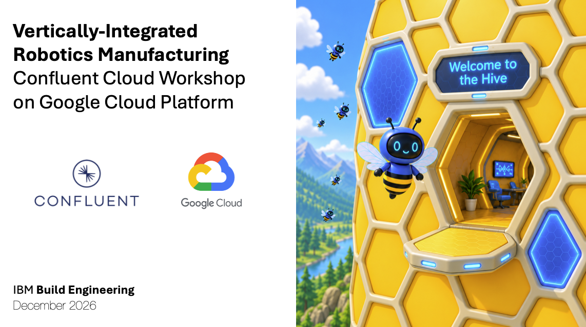
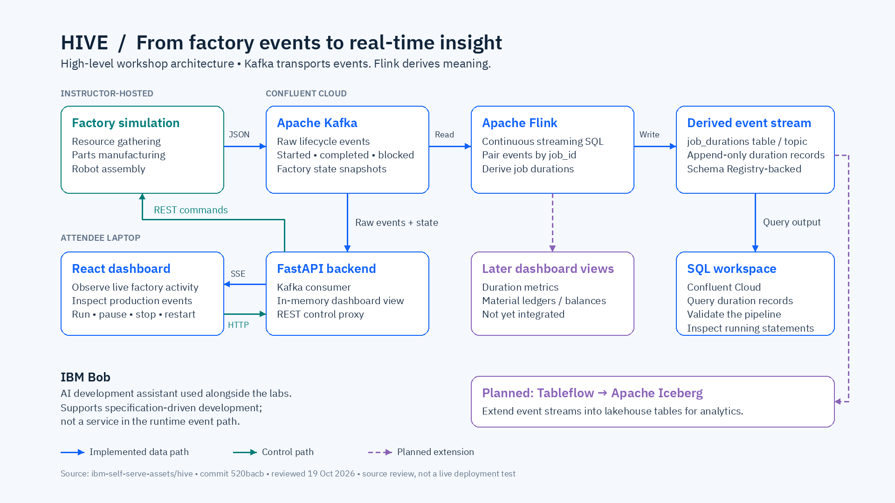

# HIVE Workshop

**HIVE** is a hands-on workshop where you connect a live robotic manufacturing simulation to Apache Kafka on Confluent Cloud and build real-time insight from its event stream. A simulated factory gathers raw materials, manufactures parts, and assembles robots — publishing every step as an event. Your job is to turn that stream of raw activity into something useful.

Over the course of the workshop you'll deploy Apache Flink SQL to correlate job-start and job-completion events into production durations, maintain live inventory balances with stateful aggregations, and validate continuously running pipelines as the simulation keeps moving. Later levels extend those streams into a lakehouse with Confluent Tableflow and hand the simulation over to an IBM Bob AI agent to manage autonomously.

## Workshop Levels
Head to **[Level 1 — Environment Setup](level-1-environment-setup/README.md)** to configure your Confluent Cloud environment, provision your Kafka topics, and launch the Hive Dashboard.

| Level | Title | Focus |
|---|---|---|
| 1 | Environment Setup | Connect to Confluent Cloud, provision topics, launch the Hive Dashboard |
| 2 | Intro to Flink | Interval joins → job duration stream (`hive_job_durations`) |
| 3 | Hive Inventory | Stateful aggregations → live inventory balances (`hive_inventory_balances`) |
| 4 | Tableflow *(planned)* | Materialize streams as Apache Iceberg tables |
| 5 | Headless Agent *(planned)* | Install IBM Bob in a headless agentic harness |
| 6 | Bob Runs the Hive *(planned)* | IBM Bob manages the simulation end-to-end |

## Architecture

