# Level 1: Kickoff & Unified Dashboard Setup

Welcome to **Level 1** of the Hive Robotics Workshop!

Over the next 15-20 mins, you will set up your development environment.  This includes:

1. Configuring your Confluent Cloud instance
2. Creating a copy of [spec-shared/.env.example](../spec-shared/.env.example) and entering your Confluent and workshop credentials.
3. Provisioning the Kafka topics your Simulation publishes into your Confluent Cloud instance.
4. Run your backend FastAPI server and a React NodeJS frontend
5. Launch the **Hive Dashboard** to get a first view your personal Hive Simulation of a vertically integrated robotics manufacturing process.

This workshop's documentation highlights why event-driven architectures is powerful, but we recommend spending time learning from these materials as well:
- Read O'Reilly's Building Event Driven Microservices to fully understand how to best implement these architectures yourself.  Your own PDF copy of **Building Event Driven Microservices** is in root directory of Level 1. Look for `confluent_building_event_driven_microservices.pdf`.
- Visit the Confluent Developer site to watch a series of short videos about [Designing Event-Driven Microservices](https://developer.confluent.io/courses/microservices/overview/).


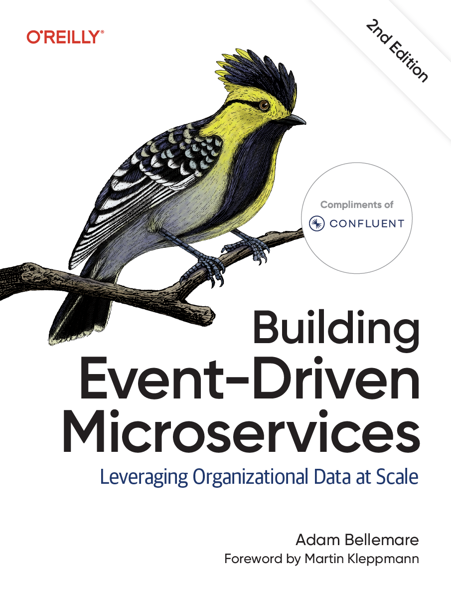

---

## Architecture Overview

To access your **Hive Simulation dashboard**, you will run these components from your laptop:

- **Backend** (`backend/`): FastAPI service that connects to Confluent Cloud via `confluent-kafka` and streams live Simulation projections to the UI over Server-Sent Events (SSE).
- **Frontend** (`frontend/`): React + TypeScript + Vite UI displaying the robotic manufacturing floor, Simulation controls, and the level progression selector.

Your Hive dashboard connects to two services:

1. **Hive Simulation Server**: simulates resource gathering, parts manufacturing, and robot assembly.  Also publishes the events that you will consume and process using Apache Flink within your Confluent CLoud insance.
2. **Confluent Cloud (event backbone)**: a managed Apache Kafka cluster that ingests every event the Simulation publishes for processing by Apache Flink and output using [TableFlow to Apache Iceberg](https://developer.confluent.io/courses/apache-iceberg/introduction/).

```
              ┌───────────────────────────────┐
              │   Simulation Server (Engine)  │
              └──────┬─────────────────▲──────┘
  Kafka events       │                 │ HTTP REST commands
  (Topics)        ▼                 │ (Run / Pause / Stop / Restart)
              ┌──────────────┐         │
              │  Confluent   │         │
              │    Cloud     │         │
              └──────┬───────┘         │
                     │ Kafka consumer  │
                     ▼                 │
              ┌──────────────────────────────┐
              │  Local Python / FastAPI      │
              │  Backend                     │
              └──────────────┬───────────────┘
                             │ Server-Sent Events (SSE)
                             ▼
              ┌───────────────────────────────┐
              │     React Dashboard (UI)      │
              └───────────────────────────────┘
```

## How the Hive Simulation works
**Key concepts**: simulation, event stream, sim-time

When running, your Simulation will generates a stream of events each second where **1 second real time = 1 minute of Simulation time**, with a max duration of **1 simulated week = 2 hours 48 minutes in actual time**.  Each event provides information about how each workstation in your robotics manufacturing Simulation is behaving.  The robotics manufacturing stations are grouped into three categories:

1. Gather resources
2. Manufacture parts 
3. Assemble robots

The Simulation starts in **Gather resources** where independent stations gather each resource.  As you explore the Simulation's event stream, you will learn that each workstation gathers its resources at different rates.  And in later Levels of the workshop, you will learn that each workstation is available in three different Tiers that determine its speed of resource gathering.  

1. Copper
2. Energy
3. Metals
4. Resin
5. Silicon

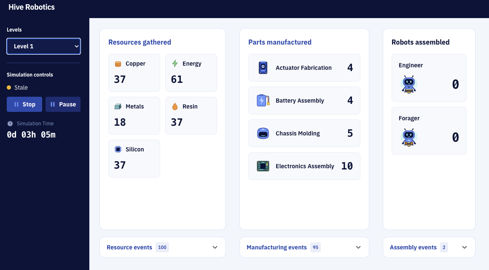

Each workstation in the **Manufacture parts** section provides the various parts required to assemble a robot:

1. Actuator
2. Battery
3. Chassis
4. Electronics

And each workstation requires its own unique input of resources to generate a part.  In a later section, you will inspect the event within the Manufacturing stations to understand how many of each resource is typically required to manufacture that part.  For instance, the resources for **Actuator Fabrication** might be similar to

- 1 Actuator  = 1 x energy + 2 metals + 1 copper

And likewise, the parts required to assemble a robot will vary depending on the robot but might be:

- 1 engineer robot  = 1 x chassis + 2 batteries + 3 electronics + 8 actuators

In future workshop Levels, you will analyze your Simulation's event stream to fully understand the dyannmics of your vertically integrated robotics manufacturing workflow.  And in final levels, you will use that information to attempt to dynamically optimize your Simulation to build more robots faster.

---

## Step 1: Prerequisites

Make sure you have:
- **Python 3.12+**
- **Node.js 18+** & npm
- A [Confluent Cloud](https://confluent.cloud) account
- Your workshop access token and attendee ID, issued by the instructor

---

## Step 2: Create Your Confluent Cloud Environment (`hive_dev`)

Skip this step if you already have a `hive_dev` environment with a Kafka cluster and an API key.

1. Log in to [Confluent Cloud](https://confluent.cloud).
2. In the left navigation, select **Environments**, then click **+ Add cloud environment**.
3. Enter `hive_dev` as the **Environment name**.
4. Under **Stream Governance package**, leave **Essentials** selected (starts at Free). This turns on **Schema Registry**, which Level 2 and Level 3 need.
5. Click **Create**.


6. Create a Kafka cluster named `hive_cluster`. Select **Basic** on the far-right as this is the least expensive option. 
7. Scroll down then select **Google Cloud** and region `Oregon (us-west1)`.
8. Click **Launch cluster**.

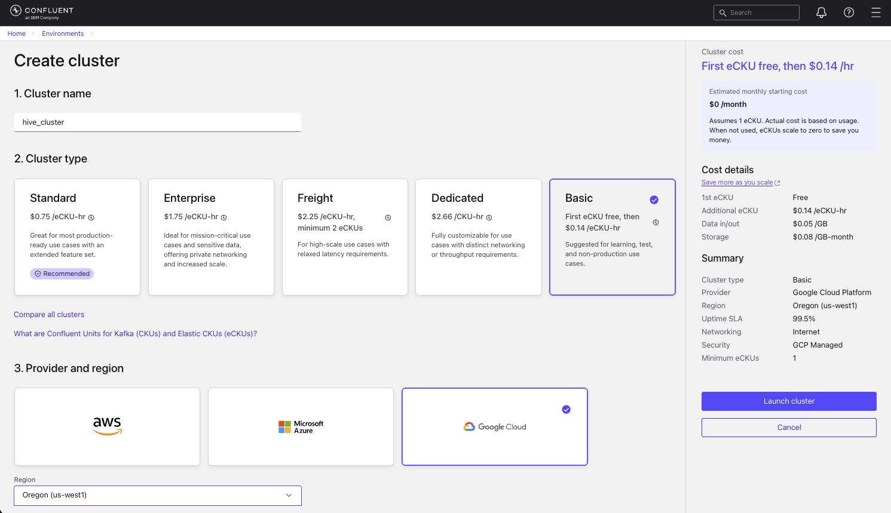

---

## Step 3: Configure Environment Credentials (`spec-shared/.env`)

The backend and topic provisioning scripts read configuration from `spec-shared/.env`.

1. Copy the example environment template from the repository root or `spec-shared/`:

   ```bash
   cp spec-shared/.env.example spec-shared/.env
   ```

2. Open [spec-shared/.env](../spec-shared/.env) in your editor and configure the following values that will be provided to your by the instructor:

   ```ini
   # Simulation server URL (the default works for a server running on your machine;
   # use the HTTPS URL from your instructor if they host it)
   SIMULATION_SERVER_URL=provided-by-the-intructor

   # Organizer-issued bearer token for authenticating with the Simulation server
   WORKSHOP_ACCESS_TOKEN=your-issued-access-token
   
   # Your attendee identifier (e.g. queen-042)
   ATTENDEE_ID=your-attendee-id
   ```

3. The Hive Simulation publishes its events into **your** Kafka cluster rather than a shared one, so it needs your cluster address and an API key that is allowed to write to it. Your dashboard needs the same values to read those events back. Each value is used as follows:

   | Value | Why it is needed | Where it is used |
   |---|---|---|
   | `CONFLUENT_BOOTSTRAP_SERVER` | The address of your Kafka cluster. | Sent to the Simulation when your dashboard registers your Simulation ([`backend/app.py`](backend/app.py#L160-L168)). Used to open the dashboard's Kafka connections ([`backend/consumer.py`](backend/consumer.py#L74-L83), [`backend/topic_watch.py`](backend/topic_watch.py#L50-L56)). |
   | `CONFLUENT_API_KEY` and `CONFLUENT_API_SECRET` | Authenticate to your cluster. | Sent to the Simulation in the same registration request so it can publish your events ([`backend/app.py`](backend/app.py#L160-L168)). Used by the dashboard to read events and check that your topics exist ([`backend/consumer.py`](backend/consumer.py#L74-L83), [`backend/topic_watch.py`](backend/topic_watch.py#L50-L56)). Also used by the topic provisioning script in [Step 4](#step-4-provision-your-kafka-topics) ([`provision_topics.py`](scripts/provision_topics.py#L197-L200)). |
   | `CONFLUENT_REST_ENDPOINT` and `CONFLUENT_CLUSTER_ID` | Address the Confluent REST API for your cluster. | Only used by the script in [Step 4](#step-4-provision-your-kafka-topics) that creates your topics ([`provision_topics.py`](scripts/provision_topics.py#L197-L200)). |

   All of these values are read from `spec-shared/.env` by the dashboard backend ([`backend/config.py`](backend/config.py#L34-L38)). They stay on your laptop except for the key, secret and bootstrap server that are sent to the Simulation, and the browser never receives them.

4. Go to your [Confluent Cloud home page](https://confluent.cloud/), open the right-side navigation panel then select **Accounts and access**.
 
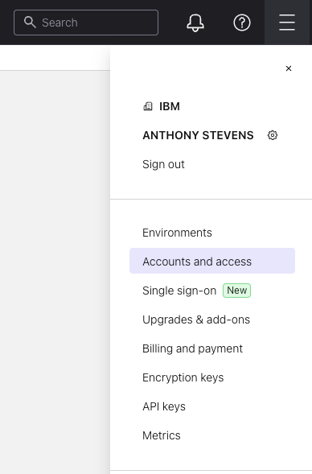

5. Click on your account name .

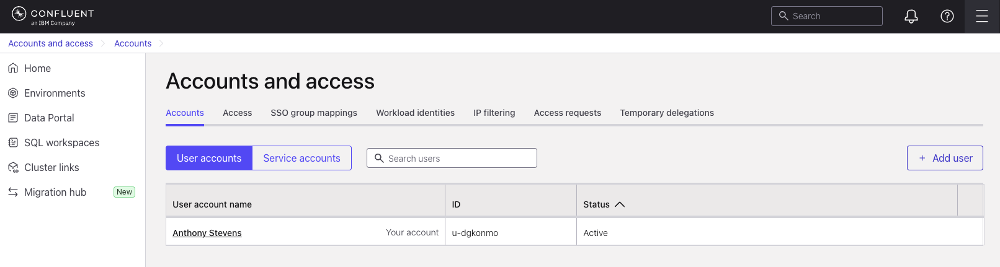

6. Select **API keys** tab then click the **Add API key**.

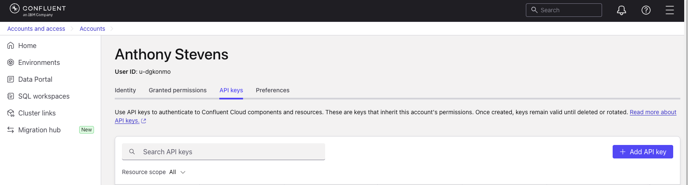

7. Enter **Name** as `hive_workshop`, skip **Description**, open the **Select key scope** dropdown and choose `Kafka cluster`, choose **Environments** as `hive_dev` and **Cluster** as `hive_cluster`

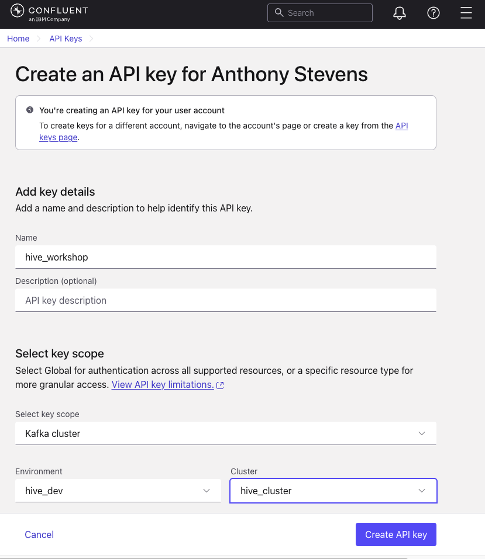

8. Click **Create API key** and copy the key and into [spec-shared/.env](../spec-shared/.env) because Confluent only shows it once.

```ini
CONFLUENT_API_KEY=your-api-key
CONFLUENT_API_SECRET=your-api-secret
```

8. Return to your [Confluent Cloud home page](https://confluent.cloud/) and select your cluster.  There are various ways to get there, but you'll end up here.  Identify your **Rest endpoint**, **Bootstrap server** and **ID** of your cluster.  Enter them into [spec-shared/.env](../spec-shared/.env).

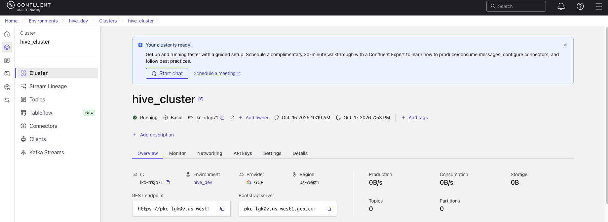

```ini
CONFLUENT_BOOTSTRAP_SERVER=pkc-xxxxx.us-west-2.aws.confluent.cloud:9092
CONFLUENT_REST_ENDPOINT=https://pkc-xxxxx.us-west-2.aws.confluent.cloud
CONFLUENT_CLUSTER_ID=lkc-xxxxxx
```
6. Save [spec-shared/.env](../spec-shared/.env).

---

## Step 4: Provision Your Kafka Topics

Your Simulation talks to the rest of the workshop by publishing events to [Kafka topics](https://developer.confluent.io/courses/apache-kafka/topics/). A topic is a named, append-only log: the Simulation writes each new event to the end of the log, and your dashboard (and later, Apache Flink) reads it from the beginning. The topics must already exist in **your** cluster before the Simulation can publish to them. The Simulation checks for them when your dashboard registers your Simulation in the next step, so you create them first.

From the repository root, run:

```bash
cd level-1-environment-setup/scripts
./provision_topics.sh
```

To preview the topic names without calling Confluent, run `./provision_topics.sh --dry-run`.

The script creates its own Python virtual environment, installs what it needs, and then creates one topic per event type. You should see a line like `✓ Created  gathering-started` for each topic. It is safe to run more than once: topics that already exist are reported as `~ Exists` and left unchanged.

### What the script does

For each topic, the script makes one call to the Confluent Cloud Kafka REST API ([`provision_topics.py`](scripts/provision_topics.py#L135-L141)):

```python
url = f"{rest_endpoint}/kafka/v3/clusters/{cluster_id}/topics"
body = json.dumps({
    "topic_name": topic_name,
    "partitions_count": 1,
    "replication_factor": 3,
    "configs": [{"name": k, "value": v} for k, v in config.items()],
}).encode()
```

- **`topic_name: topic_name`** Every event type listed under `topics` in [`spec-shared/schemas/event_payloads.json`](../spec-shared/schemas/event_payloads.json) becomes one topic, with the dot in the event name replaced by a hyphen: `gathering.started` becomes `gathering-started`. Why dots and dashes is explained in a following Note. 
- **`partitions_count: 1`.** A partition is Kafka's unit of parallelism and ordering. Events are only ordered *within* a partition, so a single partition keeps every event in a topic in the exact order it happened. That matters when you replay a simulation's history. You have one Simulation and one dashboard, so you don't need more.
- **`replication_factor: 3`.** Each event is stored on three brokers so that losing one doesn't lose data. Three copies is the standard for durability on Confluent Cloud.
- **`configs`** set how long Kafka keeps events. The script uses two different policies, described below.

> ### NOTE:
> **Why the event name has a dot but the topic name has a hyphen**
>
> You will see the same event written two ways, and each form has a different job:
>
> - **The event name uses a dot** (`gathering.started`). It reads as `thing.action`, so you can talk about a whole group of events at once, such as `*.started` or `*.completed`. Every event your Simulation publishes carries this name in its `event_type` field, and the dashboard uses it to decide how to display the event.
> - **The topic name uses a hyphen** (`gathering-started`). It is only the name of the log in Kafka. Kafka itself discourages `.` in topic names, because Kafka's metrics treat `.` and `_` as the same character, so two topics that differ only in those characters (`gathering.started` and `gathering_started`) can collide. A hyphen avoids this. It also keeps the raw event topics (`gathering-started`) visibly different from the topics you create with Apache Flink later, which use underscores (`hive_job_durations`).
>
> In Apache Flink you refer to an event by its topic name, with backticks around it because of the hyphen: ``FROM `gathering-started` ``. You never need the dotted name there.


**How long events are kept**
Kafka does not delete an event just because it has been read. Each topic has a *cleanup policy* that decides when old events go away:

| Topics | `cleanup.policy` | `retention.ms` | Why |
|---|---|---|---|
| Every event topic except `simulation-state` (`gathering-started`, `manufacturing-completed`, …) | `delete` | `86400000` (24 hours) | These are a stream of things that happened. Events older than 24 hours are discarded, which is plenty for a workshop session and keeps storage costs low. |
| `simulation-state` | `compact` | `-1` (never expires by time) | Each message is a full snapshot of the simulation. *Compaction* keeps only the most recent message for each key, so a consumer that replays the topic from the start always ends up at the current state in a single pass, however long the Simulation has been running. |

### Why this step comes before starting the backend

When your backend registers your Simulation in the next step, the Simulation first checks that every topic exists in your cluster and that it can write to them. If a topic is missing, the registration does not succeed. Creating the topics first avoids that.

---

## Step 5: Start the Backend Service

Once [spec-shared/.env](../spec-shared/.env) is configured and your topics exist, start the backend service:

```bash
cd level-1-environment-setup/backend
./start_backend.sh
```

The backend will start at `http://localhost:8001`.

### What happens when the backend starts

The first time the backend starts, it automatically connects your laptop, the Hive Simulation server and your Confluent Cloud cluster ([`backend/app.py`](backend/app.py#L121-L216)). You don't need to do anything for this to happen:

1. **It reads your configuration.** The backend loads [spec-shared/.env](../spec-shared/.env) and checks it. If a value is missing, still a placeholder such as `CHANGE_ME`, or badly formatted, it stops there and reports the problem (see [If the connection fails](#if-the-connection-fails)).
2. **It registers your Hive Dashboard with the Hive Simulation server.** The backend identifies you with your workshop access token and sends the server your Confluent bootstrap server, API key and API secret. The server creates your own personal robotic manufacturing Simulation and returns a **Simulation ID**, which the dashboard shows at the bottom of the sidebar. If you already have a simulation, the backend reconnects to it instead, and a Simulation that has finished its simulated week is replaced with a fresh one.
3. **The Hive Simulation server checks your Confluent Cloud cluster.** Using the credentials from [spec-shared/.env](../spec-shared/.env), it confirms that every event topic from [Step 4](#step-4-provision-your-kafka-topics) exists and that it is allowed to write to them, then sends a small test event to each. Once those checks pass, your Simulation is ready, and it waits in a paused state.
4. **The backend watches your cluster for the event topics.** It checks every few seconds that all of them exist, and streams the events to the dashboard in your browser as they arrive.

Your Simulation publishes nothing until you press **Run** in [Step 8](#step-8-run-your-simulation).

### If the connection fails

When a check fails, the backend prints a `CONNECTION PROBLEM` block in its terminal, and the dashboard shows the same problem in place of the factory view. Your secrets are never printed.

After you change [spec-shared/.env](../spec-shared/.env), **restart the backend** (`./start_backend.sh`). The file is only read at startup.

`CONFLUENT_CLUSTER_ID` and `CONFLUENT_REST_ENDPOINT` are only used by the topic provisioning script in [Step 4](#step-4-provision-your-kafka-topics), so the backend doesn't check them.

---

## Step 6: Start the Frontend UI

Open a second terminal and start the frontend development server:

```bash
cd level-1-environment-setup/frontend
npm install
npm run dev
```
Open your browser at **`http://localhost:5174`** (or the port displayed in your terminal).

---

## Step 7: Verification & Next Steps

When the dashboard loads, you will see the **Hive Robotics** interface.  The connection status indicator and **level selector dropdown** will be visible in the top-right.  As you advance through the workshop, you will use a Level selctor to activate each level. Automated validation tests will verify that your stream processing jobs and data pipelines are properly configured and running.  Once those tests pass, you will gain access to the level.

If you see a **Level 1 is locked** warning like the one below instead, one or more of your topics are missing from your Confluent Cloud cluster. Re-run [Step 4](#step-4-provision-your-kafka-topics) and the warning clears once every topic exists. If **Run** still doesn't work afterwards, ask your instructor to reset your simulation.

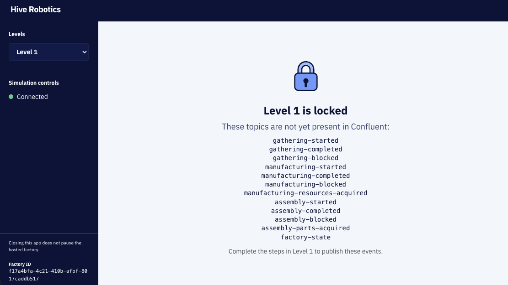

The sidebar shows **Connected** and your Simulation ID, and the Simulation controls, including **Run**, are visible. Every counter reads zero because your Simulation is paused. Continue to [Step 8](#step-8-run-your-simulation) to run your Simulation and watch its events arrive.

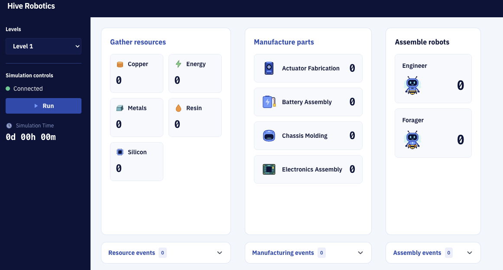

---

## Step 8: Run Your Simulation

You can start, pause, stop and restart your Simulation using controls at left in your Dashboard. Your events flow from the hosted Hive Simulation server, through Confluent Cloud to the Hive Dashboard running on your laptop:

1. **Dashboard Backend**: Connects to Confluent Cloud via `confluent-kafka` and streams raw events (`*.started`, `*.completed`, `simulation.state`) to the frontend over Server-Sent Events (SSE).
2. **Dashboard Frontend**: Displays the real-time Simulation floor, active/completed counters, sim clock (`Day X, HH:MM`), and Simulation lifecycle controls (Start, Pause, Stop, Restart).

With **Level 1** selected in the Levels dropdown, click **Run** in the Simulation controls.  

If you select the other levels, you will see warnings that they are not yet available to you.

## Step 9: Understanding Your Level 1 Dashboard

When running, the values under **Gathering resources** increment after each `gathering.completed` events is received.  Open the **Resource Events** window to see all events as they are received.

The problem is that we know how many resources have been gathered but not how long it takes to gather each.  In Level 2, you will use Apache Flink to calculate these stats as they will be useful for optimizing our system and determining how to allocate revenue generated from building robots.

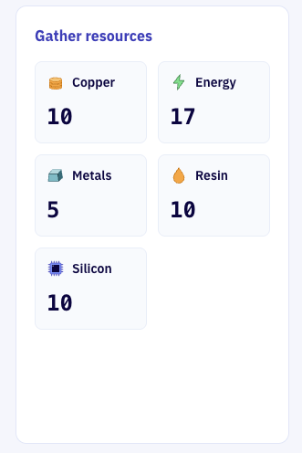
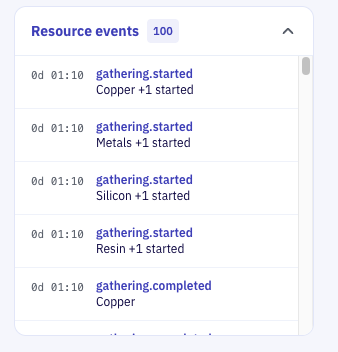

While resource values are incrementing, the **Manufacturing Parts** section remains at zero.  Run the Simulation for ~30 seconds until the you see one of the Manufacturing stations increment to `1` then click the **Pause** button. In the events panel, multiple types are displayed: `manufacturing.blocked`, `manufacturing.started`, `manufacturing.resources.acquired` and `manufacturing.completed`. 

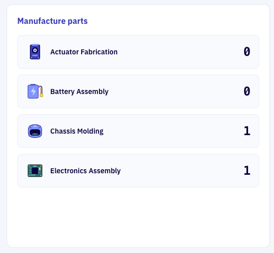
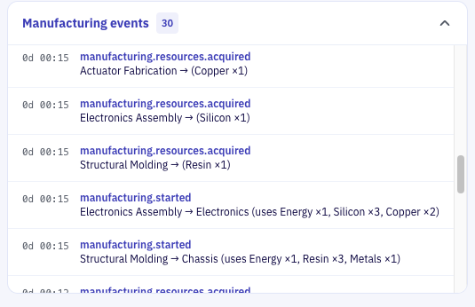

Find a `manufacturing.started` event to view a list of required inputs.  For example as above, starting assembly of an electronics module requires 1 x energy, 3 x silicon and 2 x copper. These resources are acquired at each time step, if available from the **Resources Inventory**, and a `manufacturing.resources.acquired` event is published.  A `manufacturing.blocked` event indicates a manufacturing workstation cannot proceed due to resources not-yet available in the **Resource Inventory**.

Click on any event to view full details.  In the next levels, you will learn to combine data from across events to generate new Kafka Topics and publish them into the event stream.  As you do, the UI will evolve to display deeper insights into your robotics manufacturing simulation.

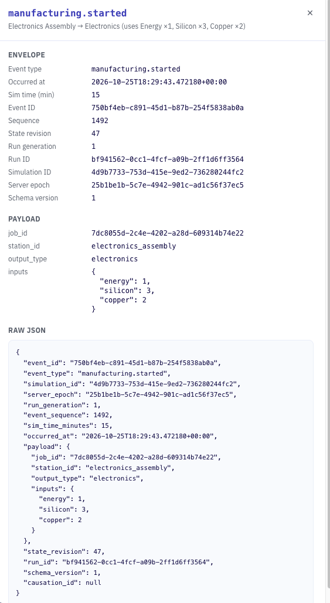


### Validation & Acceptance Criteria

- The Simulation dashboard will show **Connected** in the status pill if you have validate your attendee key and access token with the Simulation server.
- The Level 1 view unlocked once all required Kafka Topics exist in Confluent.
- Clicking **Start** initiated a Simulation run on the Simulation server.
- The Simulation clock advances (`0d 00h 00m` upwards at 1 real sec = 1 Simulation min).
- Resource gathering counters increment as resources are gathered.
- Manufacturing and robotic assembly stations will incremenet as required resources and parts are acquired.

### Next Step

Proceed to **[Level 2 — Intro to Apache Flink](../level-2-intro-to-apache-flink/README.md)** to turn the `started` and `completed` events into job durations, like the **time to gather silicon and energy resources** and the **time to generate actuators and batteries** required to assemble each robot.  These values will let you know how the production efficiency of each workstation 
