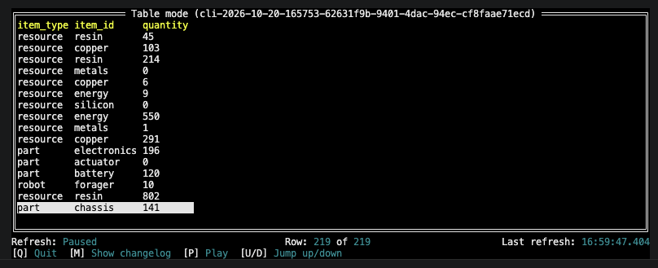
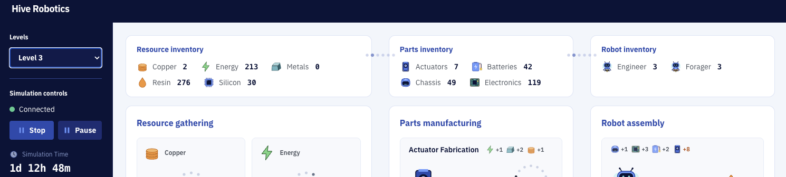
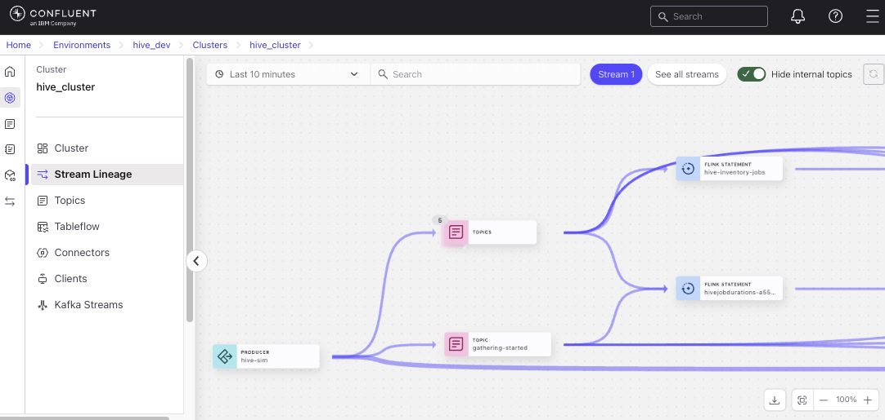
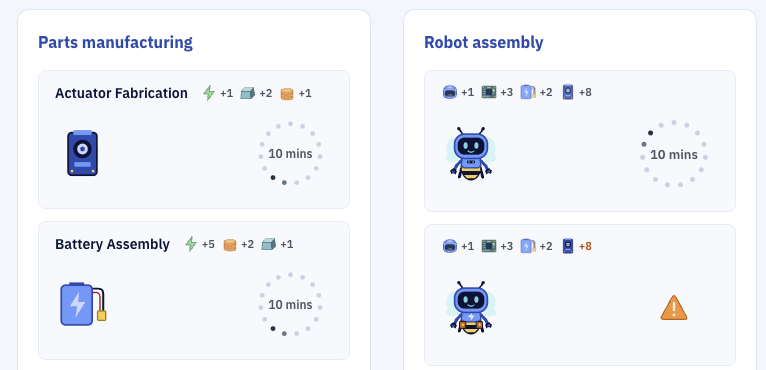

# Real-time Inventory with Apache Flink (Confluent CLI)

## Overview & Goal

In Level 2, you used Confluent Cloud's UI to execute SQL commands in Apache Flink that calcuated that `job-duration` for each Station in your manufacturing Simulation.  In Level 3, you will use the **Confluent CLI** to calculate teh **Live Inventory** for your Simulation: how many resources, parts, and robots are in stock or surplus.

**The Problem:** Raw Simulation events record only what was produced or consumed at a single instant.  There is no event that says "there are currently 7 units of copper in inventory."

**Your Objective:** Use Apache Flink stateful aggregations to maintain a continuously updated inventory balance for every item in the Simulation:

- **Resources** arrive via `gathering.completed` and are consumed when manufacturing stations start jobs (`manufacturing.started` inputs).
- **Parts** arrive via `manufacturing.completed` and are consumed when assembly starts (`assembly.started` inputs).
- **Robots** accumulate via `assembly.completed` and are never consumed.

### New Kafka Topic: hive_inventory_balances

```
gathering-completed  ──┐
                        ├──► Flink stateful SUM  ───►  hive_inventory_balances
manufacturing-started ──┘        (per item_id)          (upsert changelog)

manufacturing-completed ──┐ 
                           ├──► Flink stateful SUM ───►  hive_inventory_balances
assembly-started ──────────┘

assembly-completed ────────────► Flink stateful SUM ───►  hive_inventory_balances
```

### Why is this important in Event Streaming? (Stream vs. Table)

A foundational concept in event-driven architecture is the **stream-table duality**: a stream represents a history of change (what happened), while a table represents the current state of the world (what is). 

* **Append-Only Streams (Level 2):** Traditional Kafka topics are immutable, append-only event logs. Every single action (e.g., `+1 Copper added`, `-2 Copper consumed`) creates a new record. While great for auditing history, asking *"How much copper do we have in stock right now?"* would require a consumer to replay and sum every transaction from the beginning of time.
* **Upsert Changelog / Materialized State (Level 3):** By configuring `hive_inventory_balances` with `changelog.mode = 'upsert'` and a primary key (`item_id`), Apache Flink turns the stream of delta events into a **live materialized table**.
* **The Result:** Flink handles all the running sums in internal state and emits the latest balance per item. Downstream applications (like your UI dashboard) don't have to scan millions of historical events — they instantly read the current state of each item directly.

---

## Prerequisites

- Level 2 is complete: `hive_job_durations` exists and the stream processing statement is **Running**.
- The Simulation is running and events are flowing.
- The Confluent CLI is installed (instructions below if not).

---

## Step 1 — Install the Confluent CLI

### macOS

Via Homebrew (recommended):
```bash
brew install confluentinc/tap/cli
```
No Homebrew or no admin rights? Install to your home directory instead (avoids `/usr/local/bin` permission errors):
```bash
curl -sL --http1.1 https://cnfl.io/cli | sh -s -- -b $HOME/.local/bin
echo 'export PATH="$HOME/.local/bin:$PATH"' >> ~/.zshrc && source ~/.zshrc
```
> Using bash instead of zsh? Use `~/.bash_profile` in place of `~/.zshrc`. Check your shell with `echo $SHELL`.

### Windows

Via winget:
```powershell
winget install Confluent.ConfluentCLI
```
Or via PowerShell:
```powershell
Invoke-WebRequest -Uri https://cnfl.io/cli -OutFile confluent-cli-install.ps1
powershell -ExecutionPolicy Bypass -File confluent-cli-install.ps1 -bin %USERPROFILE%\bin
```

### Verify
```bash
confluent version
```

---

## Step 2 — Authenticate & Set Context

```bash
# Log in (opens browser)
confluent login --save

# List environments and select yours
confluent environment list
# <ENV_ID> looks like env-abc123
confluent environment use <ENV_ID>

# List Kafka clusters and select yours
confluent kafka cluster list
# <CLUSTER_ID> looks like lkc-xyz789
confluent kafka cluster use <CLUSTER_ID>

# List Flink compute pools and note your pool ID
confluent flink compute-pool list

# List Flink compute pools and note your pool ID
confluent flink compute-pool use <POOL_ID>

# Select the cloud and region your cluster and compute pool run in
# (replace <REGION> with a value from the table below, e.g. us-west1)
confluent flink region use --cloud gcp --region <REGION>

# Then select the matching Flink endpoint (run this AFTER the region command)
confluent flink endpoint use "https://flink.<REGION>.gcp.confluent.cloud"
```

Without the region, commands such as `confluent flink statement delete`, `list` and `describe` fail with `no cloud provider and region selected`. Without the endpoint, every Flink command prints `No Flink endpoint is specified, defaulting to public endpoint`. That notice is harmless, but setting the endpoint removes it. Changing the region unsets the endpoint, so always run the region command first.

### Export environment, cluster and compute pool IDs for use by CLI

Use the same values as in the prior steps to store the same values as shell variables:

#### macOS / Linux (bash/zsh)
```bash
export ENV_ID=<ENV_ID>
export CLUSTER_ID=<CLUSTER_ID>
export POOL_ID=<COMPUTE_POOL_ID>
```

Validate presence of your variables.  Ensure no extra spaces are present.
```bash
echo $ENV_ID/$CLUSTER_ID/$POOL_ID
```

#### Windows (PowerShell)
```powershell
$env:ENV_ID="<ENV_ID>"
$env:CLUSTER_ID="<CLUSTER_ID>"
$env:POOL_ID="<COMPUTE_POOL_ID>"
```

Validate presence of your variables.  Ensure no extra spaces are present.
```powershell
echo $env:ENV_ID/$env:CLUSTER_ID/$env:POOL_ID
```

---

## Step 3 — Create the Inventory Sink Table

**NOTE:** To run the following commands, ensure your Terminal window is in the Level 3 directory.

Create the `hive_inventory_balances` table in Flink and the backing Kafka topic with upsert changelog mode. 

```bash
confluent flink statement create hive-inventory-sink \
  --compute-pool $POOL_ID \
  --environment $ENV_ID \
  --database $CLUSTER_ID \
  --sql "$(cat flink/01_create_sink.sql)" > /dev/null
```

The `> /dev/null` hides the CLI's echo of the whole SQL file. Errors are still shown.

Confirm it succeeded:
```bash
confluent flink statement describe hive-inventory-sink -o json | grep -E '"(status|status_detail)"'
```

**Expected result:** status `COMPLETED`. This is a DDL statement — it runs once and finishes. It starts as `PENDING`, so wait a few seconds and check again.  

If the status is `FAILED`, the `status_detail` line explains why.

---

## Step 4 — Start the Inventory Jobs

Run `02_run_jobs.sql` to start the continuous streaming statement. This submits three parallel aggregation jobs (resources, parts, robots) bundled into a single Flink statement.

```bash
confluent flink statement create hive-inventory-jobs \
  --compute-pool $POOL_ID \
  --environment $ENV_ID \
  --database $CLUSTER_ID \
  --sql "$(cat flink/02_run_jobs.sql)" > /dev/null
```

Confirm it succeeded:

```bash
confluent flink statement describe hive-inventory-jobs -o json | grep -E '"(status|status_detail)"'
```

**Expected result:** status `RUNNING`. Unlike the DDL above, this DML statement runs indefinitely — do not delete it. It starts as `PENDING` and can take a minute or two to reach `RUNNING`.  

Ensure status is `RUNNING` before proceeding further.

> **Understanding DDL vs. DML in Flink:**
> - **DDL (Data Definition Language):** Commands like `CREATE TABLE` that define schemas, tables, and connectors. They run once, establish the metadata, and finish immediately with status `COMPLETED`.
> - **DML (Data Manipulation Language):** Commands like `INSERT INTO ... SELECT` that move, transform, and aggregate data. In streaming systems like Apache Flink, DML statements run continuously in the background with status `RUNNING` to process live events as they arrive.

---

## Step 5 — Validate using Flink Shell

> **What is the Flink Shell?**
> The Flink Shell is an interactive SQL prompt that connects directly to your Confluent Cloud compute pool. Unlike the Confluent Cloud UI editor — which is better suited to writing and saving named statements — the shell is ideal for quick, one-off queries: checking what data is in a table, verifying a job's output, or debugging a schema. Think of it the way you'd use `psql` or the MySQL CLI: not where you author your production SQL, but where you poke around to confirm things are working.
>
> This is the first time in the workshop we use it because it's the right tool for reading live output interactively — you can watch inventory values change in real time as the Simulation runs, which the shell handles naturally. Use it any time you want to inspect a Flink-managed topic, run a quick `SELECT`, or test a query before committing it to a permanent statement.

The jobs from Step 4 are running, but nothing so far has shown you their output. In this step you'll use Flink Shell to read the `hive_inventory_balances` table to confirm that Flink is keeping a current stock count for every resource, part, and robot. The Simulation should be running so that you can see the numbers change.

**1. Open the Flink shell.** This is an interactive window where you type SQL and see the results.
```bash
confluent flink shell \
  --compute-pool $POOL_ID \
  --environment $ENV_ID \
  --database $CLUSTER_ID
```
A `>` prompt appears when the shell is ready.

**2. Copy the query** from `flink/03_validate.sql`, paste it at the `>` prompt.  The Shell will likely  display a typeahead hint, but ignore it and press **Enter**

**3. Read the result.** You will inititially see `statement phase pending` then a table of results will open after a delay of 5-10 seconds.  This table will auto-update while the Simulation runs. It is not sorted, because Flink cannot sort a live stream. 



You should see:
- one row for each of the 5 resources, 4 parts and 2 robots for the current run (11 rows);
- quantities that change as the Simulation runs;
- no negative numbers.
- If you restarted the simulation, the table will show earlier runs too. Each run has its own `run_id`.

**4. Open dashboard and select Level 3.** Your Dashboard has an Inventory that shows the same results as in the Flink Shell with a single, but major caveat.

The Simulation dashboard updates in near real-time — typically within a second of a new value being written — while the Flink Shell lags by up to a minute. Both are reading from the same `hive_inventory_balances` Kafka topic, but with different isolation levels. The dashboard backend uses `read_uncommitted`, so it sees records the moment Flink writes them. The Flink Shell uses `read_committed` (the default), so it only sees records after Flink's checkpoint transaction commits — which happens on the checkpoint interval, roughly once per minute on Confluent Cloud. The "Last Refresh" timer in the shell is just the shell's own display refresh rate, not an indicator of when new data arrived.



**4. Close the results and the shell.** Press `Q` to close the results. Then type `EXIT;` or press `Ctrl+D` to close the shell.

> **Gate Check:** The dashboard Level 3 view unlocks once the `hive_inventory_balances` topic exists. Running `01_create_sink.sql` (Step 3) creates it.

---

## How the Inventory Calculation Works

### Resources
```
resources[item_id] =
    SUM(gathering-completed.payload.quantity   WHERE station_id = item_id)
  − SUM(manufacturing-started.payload.inputs[item_id])
```
Resources are delivered by gathering jobs and consumed when manufacturing stations start.

### Parts
```
parts[item_id] =
    SUM(manufacturing-completed.payload.quantity  WHERE part_id = item_id)
  − SUM(assembly-started.payload.inputs[item_id])
```
Parts are produced by manufacturing completions and consumed when assembly stations start.

### Robots
```
robots[output_type] = SUM(assembly-completed.payload.quantity  WHERE output_type = item_id)
```
Robots only accumulate at the moment — nothing consumes them.

---

## Useful CLI Commands

```bash
# Short status of one statement (the plain `describe` and `list` print the whole SQL)
confluent flink statement describe hive-inventory-jobs -o json | grep -E '"(name|status|status_detail)"'

# Stop a statement (use only if you need to restart).
# Deleting is not instant: wait a few seconds, until the name is free, before creating it again.
confluent flink statement delete hive-inventory-jobs

# Open an interactive SQL shell
confluent flink shell \
  --compute-pool $POOL_ID \
  --environment $ENV_ID \
  --database $CLUSTER_ID
```

---

## Visualizing Topics with Stream Lineage

Now that you have both raw event topics and derived stream processing pipelines active, you can use Confluent Cloud's **Stream Lineage** feature to visually inspect the end-to-end data flow graph across your cluster.

Stream Lineage is built into Stream Governance (Essentials) and automatically tracks event provenance across producers, Kafka topics, Flink stream processing statements, and consumer applications without any manual instrumentation.

### How to Access Stream Lineage

1. Open the [Confluent Cloud Console](https://confluent.cloud).
2. Select your **`hive_dev`** environment.
3. Click into your Kafka cluster (e.g. `hive_cluster`).
4. In the left navigation menu under your cluster, click **Stream Lineage**.



### Exploring the simulation Topics and Statements

- **Producer:** Topics flow from the Simulation producer and into the Flink Statements that you created. Click on the Topic icons in the Stream Lineage UI to trace events originating from the Simulation across raw topics such as `gathering-completed`, `manufacturing-started`, `manufacturing-completed`, `assembly-started`, and `assembly-completed`.
- **Flink Statements:** Identify the Flink Statement nodes representing your running `hive-inventory-jobs` statement set (as well as Level 2's `hive_job_durations` joins).
- **Derived Sink Topic:** Observe the flow routing into the `hive_inventory_balances` (the upsert changelog table) and `hive_job_durations` topics.
- **Downstream Consumers:** Locate the consumer application nodes representing your local Hive Dashboard backend service reading the live inventory balances and raw events.
- **Node & Stream Inspection:** Click on any topic or stream edge in the lineage graph to view real-time throughput metrics (records/sec, bytes/sec), active schemas registered in Schema Registry, partition distributions, and consumer lag.

---

## Explore the Level 3 Dashboard

The Level 3 dashboard contains a real-time Inventory of available resources, parts and robots which is updated from your new `hive_inventory_balances` topic.  By observing the parts manufacturing events, you can see that `manufacturing-started` events coincide with the total resources being reduced by the required input amounts.  Likewise the parts inventory is seen to reduce when the `assembly-started` event appears, as expected.


You will also see that each manufacturing and robot assembly stations now show their required inputs.  This value is obtained from the `manufacturing-started` and `assembly-started` events.



### Lavel 4: Order Fulfillment

You may be asking yourself, what is the motivating force behind manufacturing these robots.  Surely someone placed an order for them, because while it might be nice to give robots away for free, your manufacturing workflow needs to generate revenue to afford workstation ugrades and even purchase more workstations as required.  Level 4 adds the concept of Order Fullfilment to address this need.

## Next Step

After exploring the updated Simulation Dashboard, proceed to [Level 4 - Order Fulfillment](../level-4-order-fulfillment/README.md). 

