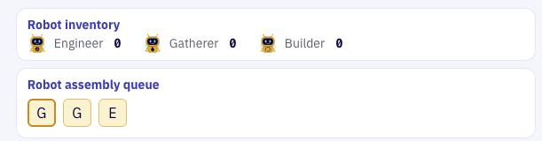

# Order Fulfillment and Priotitizing Parts Manufacturing

## Overview & Goal

At the end of Level 3, you may have noticed a new UI element in the top-right of your Hive Dashboard: the list of orders for robots appears in the **Robot assembly queue**.  As below, there are 3 orders in the queue: 2 x **G**atherer robots followed by an **E**ngineer robot.  The left-most icon indicates the next robot in queue to be assembled once parts are available.

This highlights a new challenge. How do we prioritize manufacturing parts based on robot orders in the queue?  The **Robot Assembly** stations "know" the parts required to assemble their robots.  However **Robot Assembly** is independent of **Parts Manufacturing**, so how can we prioritize parts manufacturing in real-time?  Event-driven architecture design!

## Parts Manufacturing Queue

The non-event driven solution to our problem would be to add a hard-coded REST call to `place orders for parts based on the next robot in the assembly queue`.  Instead, you will use Flink produce a new event Topic to inform a **Parts Manufacturing Queue**

