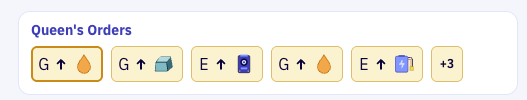

# The Queen's Orders

## Overview & Goal

You are getting closer to implementing your AI Queen.  First, you need to add logic to integrate your queen with the other systems in your hive.  The **Queen** decides which new Worker robots are required to improve the Hive and in what order. And she does this by publishing an `queen-worker-ordered` event.  You may have noticed this event earlier when you intially provisioned all the events provided by the Hive Simulation server.

**The Problem:** The Queen's order for a new Worker (`queen-worker-ordered`) is separate from the `assembly-started` and `queen-worker-assigned` events.  So there is no single event says "here is the **Queen's Worker Order** queue right now.  To know what is waiting to be built, every event consumer would have to cache every order and subtract the ones already in assembly or assigned, which means also tracking the assembly status of Worker robots in the Assembly process.

**Your Objective:** Use Apache Flink to fold these events into a `queens_orders` table with one row per order.  Your Hive Dashboard can then read that table to render a **Worker Order Queue**.

### Types of Worker Orders?

The Queen can order three kinds of **Workers**.  Each order names the workstation the Worker is for:

| Worker Type | What it does | Allowed Units | `action` |
|---|---|---|---|
| **Gatherer** | Adds gatherer to a region | `copper`, `energy`, `metals`, `resin`, `silicon` | `upgrade` |
| **Engineer** | Upgrade up a workstation | Manufacturing or assembly stations only | `upgrade` |
| **Builder** | Adds a new workstation | Manufacturing or Assembly | `add` |

> **Not wired up yet:** a finished robot is assigned to its order (`queen-worker-assigned`), but the assignment does not change the station yet.  The dashboard therefore shows the queue and its status changes, and the stations keep their starting tiers.

### New Kafka Topics and Table

Your Hive Simulation includes these two topics:

| Topic | Written when |
|---|---|
| `queen-worker-ordered` | The Queen places an order. Carries `order_id`, `robot_type`, `workstation_type`, `workstation_id`, `action`. |
| `queen-worker-assigned` | A robot finished assembly and was assigned. `causation_id` is the id of the `assembly-completed` event. |

Note that we must also track when the Queen's orders have been processed.  The `assembly-started` topic triggers the removal of an order from the open order queue.  So your Flink SQL must process these 3 topics to track status of the Queen's order queue:

```
queen-worker-ordered  ───┐
assembly-started      ───┼──► Flink GROUP BY order_id ───►  queens_orders
queen-worker-assigned ───┘   (highest lifecycle_stage wins)  (upsert changelog)
```

Flink gives every event a `lifecycle_stage`, groups the events by `order_id`, and the highest `lifecycle_stage` seen for an order becomes its status:

| Event | `lifecycle_stage` | Status |
|---|---|---|
| `queen-worker-ordered` | 1 | `OPEN` |
| `assembly-started` (with an `order_id`) | 2 | `IN_ASSEMBLY` |
| `queen-worker-assigned` | 3 | `ASSIGNED` |

---

## Why is this important in Event Streaming? (Event Sourcing)

* **Commands become facts.** The Queen does not edit a queue.  She publishes `queen-worker-ordered` events, and each is a permanent record of what she decided and when.
* **State is derived.** The queue is a *projection* of those events.  Flink holds the running state and emits the latest row per order, exactly like the inventory balance in Level 3, but keyed by `order_id` instead of by item.
* **Anyone can build their own view.** The dashboard reads `queens_orders`, but a different team could read the same `queen-worker-ordered` and `queen-worker-assigned` topics and build an audit trail or a fairness report, without any change to the Simulation.

---

## Prerequisites

- Level 3 is complete: `resource_inventory` and `parts_inventory` exist and their statements are **Running**.
- The Simulation is running and events are flowing.
- You know how to execute a Flink SQL script in Confluent Cloud, using either the **Confluent Cloud UI** (Level 2) or the **Confluent CLI** (Level 3).

---

## Run the Level 4 Scripts

Execute the first three scripts in the [`flink/`](flink/) directory, in order, using whichever method you prefer: the **Confluent Cloud UI** (as in Level 2) or the **Confluent CLI** (as in Level 3).  The steps are the same as in those levels, only the SQL files are new.

| Step | Script | Type | Expected status |
|---|---|---|---|
| 1 | [`01_create_sink.sql`](flink/01_create_sink.sql) | DDL: runs once | `COMPLETED` |
| 2 | [`02_run_jobs.sql`](flink/02_run_jobs.sql) | DML: runs continuously | `RUNNING` |
| 3 | [`03_validate.sql`](flink/03_validate.sql) | Query: for checking only | Results appear |

If you use the CLI, run the commands from the **Level 4 directory** with the same `$ENV_ID`, `$CLUSTER_ID` and `$POOL_ID` variables as Level 3.  Suggested statement names are `hive-queens-orders-sink` and `hive-queens-orders-jobs`.

---

## Step 1 — Create the Orders Sink Table

Execute `01_create_sink.sql`.  It creates the `queens_orders` table in Flink and the backing Kafka topic with upsert changelog mode.  This is a DDL statement, so it runs once and finishes with status `COMPLETED`.

The table has one row per order:

| Column | Meaning |
|---|---|
| `simulation_id`, `run_id`, `order_id` | The primary key. `run_id` changes when the Simulation restarts. |
| `robot_type` | `gatherer`, `engineer` or `builder` |
| `workstation_type` | The type of workstation the robot is for, e.g. `resin` |
| `workstation_id` | The workstation of that type to upgrade (1 to 4). Empty for a Builder order: the new workstation takes the next id when it is built. |
| `action` | `upgrade` or `add` |
| `placed_seq` | The `event_sequence` of the order. Lower means earlier in the queue. |
| `status` | `OPEN`, `IN_ASSEMBLY` or `ASSIGNED` |

---

## Step 2 — Start the Orders Job

Execute `02_run_jobs.sql` to start the continuous streaming statement.  It starts as `PENDING` and can take a minute or two to reach `RUNNING`.  Do not continue until it is `RUNNING`, and leave it running: the dashboard's Level 4 view depends on it.

### How the Queue Is Computed

The job applies the `lifecycle_stage` table from the overview above.  Two details are worth noticing:

* **`lifecycle_stage` makes the result order-independent.** Events from different topics can reach Flink in any order.  Taking the highest `lifecycle_stage` means an order never moves backwards, even if `assembly-started` arrives before `queen-worker-ordered`.
* **`MAX()` fills the gaps.** Only some events carry `robot_type`, `workstation_type`, `workstation_id` and `action`.  `MAX()` ignores `NULL`, so whichever event brings a value fills it in.  `placed_seq` comes only from the ordered event.

Orders cannot be cancelled: once the Queen places an order it stays until its robot is built and assigned.

The **queue** on the dashboard is the rows with `status = 'OPEN'`, sorted by `placed_seq`: first in, first out.

---

## Step 3 — Validate the Results

Execute the query in `03_validate.sql`, either in a new cell of the Flink SQL Workspace or at the prompt of the Flink shell (`confluent flink shell --compute-pool $POOL_ID --environment $ENV_ID --database $CLUSTER_ID`).  The Simulation should be running so you can watch the rows change.  After a delay of 5-10 seconds a table of results appears and auto-updates.

You should see:
- On a fresh run, 3 rows, all `OPEN`: the Queen's initial orders.
- Rows move to `IN_ASSEMBLY` as the assembly line starts building them, then to `ASSIGNED` once the robot is built.
- If you restarted the Simulation, earlier runs are listed too.  Each run has its own `run_id`.

When you have verified the results, stop this query (**Stop** in the UI, or press `Q` in the shell, then `EXIT;` or `Ctrl+D` to close it).  Only the `02_run_jobs.sql` statement needs to keep running.

**Congratulations! Level 4 Achieved!!!**

Open your Hive Dashboard and select **Level 4.**  The queue on screen is the same data as in the validation query.  The dashboard updates within a second of a new value being written, while the Flink Shell can lag by up to a minute.  Both read the same `queens_orders` topic, but the dashboard backend uses `read_uncommitted` and the shell uses `read_committed`, which only shows records after Flink's checkpoint transaction commits.

> **Gate Check:** The dashboard Level 4 view unlocks once the `queens_orders` topic exists.  Running `01_create_sink.sql` (Step 1) creates it.

---

## Explore the Level 4 Dashboard

Level 4 will now be active so you can view the **Queen's orders** as a banner across the top of the Parts manufacturing and Worker robot assembly sections of your Hive Dashboard.  There is one card per open order, and the left-most card, with the gold border, is the next robot to be assembled once parts are available.



Each card shows:

- **The robot:** Gatherer, Engineer or Builder.
- **What it will do:** the workstation's icon with an up arrow (upgrade) or a plus sign (add a new workstation).
- **Parts required:** the number of actuators, batteries, chassis and electronics that robot needs.  This row appears once you have completed the Parts Manufacturing Prioritization steps below.

The parts you have in stock are shown under the **Parts manufacturing** heading.

---

## Part Prioritization

The queue answers *what* the Hive should build next.  It raises a new question: how do we prioritize **parts manufacturing** based on the next Worker in the queue?

The **Robot Assembly** stations "know" the parts they need, but they are independent of **Parts Manufacturing**.  The non-event-driven solution would be a hard-coded REST call to place orders for parts based on the next robot in the queue.  Instead, you'll use Flink to join `queens_orders` with the parts each robot needs, from `assembly-state`, and produce a new topic that drives a **Parts Manufacturing Queue**.

## Parts Manufacturing Prioritization

The problem with isolated systems within any Organization is that they struggle to coordinate their activities.  Especially when it's a Queen isolated in the Hive's safest interior.  Execution of the Queen's orders requires tight coordination between the Part Manufacturing and Worker Assembly teams.  To achieve this, every order in the Queen's queue needs to say which parts its **Worker Bee** is built from.

The Simulation publishes that recipe in `assembly-state`, one message per assembly workstation, at the start of every run.  So the recipe is known before the first robot is built.

From `assembly-state` for a **Gatherer Worker**:
``` json
"workstation_type": "gatherer",
"workstation_id": 1,
"output_type": "gatherer",
"parts_required": {
  "chassis": 2,
  "electronics": 1,
  "battery": 5,
  "actuator": 6
},
"tier": 1
```

Pairing this with each `queens_orders` row generates a `parts_priority_queue`: the Queen's orders, each with the parts its robot needs.  The Parts Manufacturing Team reads it from the front of the queue, because the next robot to build is the one whose parts matter most.

```
assembly-state ──► recipe per robot type ───┐
                   (payload.parts_required)  ├──► Flink JOIN ──► parts_priority_queue
queens_orders ──► every order ──────────────┘                   (upsert changelog)
```

### How the Priority Is Computed

1. **Identify required parts.** Each `assembly-state` message lists the parts its robot consumes.  Flink keeps one recipe per robot type (`gatherer`, `engineer`, `builder`) and reads each part by name, as in Level 3.  The recipe never changes, so `MAX()` is safe even though the topic can hold several messages for one robot type (at the start of a run, and again after each upgrade).
2. **Join.** Each order in `queens_orders` is joined to the recipe of its `robot_type`.  Nothing is summed and nothing is filtered, so there is one row per order.
3. **Read the queue.** The rows with `status = 'OPEN'`, sorted by `placed_seq`, are the Queen's queue.  The first row is the next robot to build, so its parts are the ones that matter most.

With the Simulation's starting rules, the recipes are:

| `robot_type` | `actuator` | `battery` | `chassis` | `electronics` |
|---|---|---|---|---|
| `gatherer` | 6 | 5 | 2 | 1 |
| `engineer` | 8 | 2 | 1 | 3 |
| `builder` | 10 | 4 | 3 | 2 |

So if the Queen's open orders are one Gatherer, one Engineer and one Builder, in that order, `parts_priority_queue` holds three rows, one per order, each carrying the numbers on its own line above.

When assembly starts for the Gatherer, its row changes to `IN_ASSEMBLY`.  The parts stay on the row.

> **How the order of the queue is used:** this level only shows the parts on each order.  Deciding which part to manufacture next is a separate function, not covered here.

### Run Scripts

Run the three new scripts in the [`flink/`](flink/) directory, in order, using whichever method you prefer: the **Confluent Cloud UI** (as in Level 2) or the **Confluent CLI** (as in Level 3).  You can use a different method for each step; the result is the same.

| Step | Script | Type | Expected status |
|---|---|---|---|
| 4 | [`04_create_priority_sink.sql`](flink/04_create_priority_sink.sql) | DDL: runs once | `COMPLETED` |
| 5 | [`05_run_priority_job.sql`](flink/05_run_priority_job.sql) | DML: runs continuously | `RUNNING` |
| 6 | [`06_validate_priority.sql`](flink/06_validate_priority.sql) | Query: for checking only | Results appear |

**Before you start:**
- The `hive-queens-orders-jobs` statement from Step 2 is still **Running**.  The new job reads from `queens_orders`, so it cannot produce anything without it.
- The Simulation is running and its timer is incrementing.
- **UI users:** open your Flink **SQL Workspace** in the `hive_dev` environment, with the same catalog (environment) and database (cluster) selected as in Level 2, and have 3 empty cells ready (click **+** as needed).
- **CLI users:** open a terminal in the **Level 4 directory** (`hive-attendee/level-4-queens-orders`) with the `$ENV_ID`, `$CLUSTER_ID` and `$POOL_ID` variables from Level 3 still set.  Check with `echo $ENV_ID/$CLUSTER_ID/$POOL_ID`.

### Step 4 — Create the Priority Sink Table

`04_create_priority_sink.sql` creates the `parts_priority_queue` table in Flink and its backing Kafka topic, with upsert changelog mode.  It is a DDL statement, so it runs once and finishes with status `COMPLETED`.

The table has one row per order: every column of `queens_orders`, plus the parts the order's robot needs:

| Column | Meaning |
|---|---|
| `simulation_id`, `run_id`, `order_id` | The primary key, as in `queens_orders`. |
| `robot_type`, `workstation_type`, `workstation_id`, `action`, `placed_seq`, `status` | Copied from `queens_orders`. |
| `actuator`, `battery`, `chassis`, `electronics` | Units of each part one robot of this type needs. Empty if the recipe does not use the part. |

**Using the UI**
1. Open [`flink/04_create_priority_sink.sql`](flink/04_create_priority_sink.sql), copy the entire contents and paste them into the **first workspace cell**.
2. Set the cell's **Mode** (bottom-right) to **Snapshot**, then click **Run**.
3. Wait for the status **Completed**.

**Using the CLI**
```bash
confluent flink statement create hive-parts-priority-sink \
  --compute-pool $POOL_ID \
  --environment $ENV_ID \
  --database $CLUSTER_ID \
  --sql "$(cat flink/04_create_priority_sink.sql)" > /dev/null

confluent flink statement describe hive-parts-priority-sink -o json | grep -E '"(status|status_detail)"'
```
The `> /dev/null` hides the CLI's echo of the whole SQL file; errors are still shown.  The status starts as `PENDING`, so repeat the `describe` command after a few seconds until it shows `COMPLETED`.  If it shows `FAILED`, the `status_detail` line explains why.

---

### Step 5 — Start the Priority Job

`05_run_priority_job.sql` starts the continuous statement that joins every order in `queens_orders` with the robot recipes from `assembly-state`, and keeps `parts_priority_queue` up to date.  It starts as `PENDING` and can take a minute or two to reach `RUNNING`.  Do not continue until it is `RUNNING`, and leave it running.

**Using the UI**
1. Open [`flink/05_run_priority_job.sql`](flink/05_run_priority_job.sql), copy the entire contents and paste them into the **second workspace cell**.
2. Click **Run**.  The status is **Running** once it has started.
3. Do **not** click **Stop**: that terminates the job.  You can close the SQL Workspace after Step 6 and the job keeps running in the background.
4. To check it later, go to **Flink** → **Statements** in the `hive_dev` environment.  The statement of type **Execute Statement Set** must have status **Running**.

**Using the CLI**
```bash
confluent flink statement create hive-parts-priority-jobs \
  --compute-pool $POOL_ID \
  --environment $ENV_ID \
  --database $CLUSTER_ID \
  --sql "$(cat flink/05_run_priority_job.sql)" > /dev/null

confluent flink statement describe hive-parts-priority-jobs -o json | grep -E '"(status|status_detail)"'
```
This command may take a few seconds to return.  Repeat the `describe` command until it shows `RUNNING`.

> **Expected warnings:** The Confluent Cloud UI may show 3 warnings on this statement: `STATE_INTENSIVE_AGG_FUNCTION`, `UPSERT_AND_PRIMARY_KEYS_DIFFERENT` and `HIGH_STATE_OPERATOR_WITHOUT_TTL`.  They are expected and the job still runs.  They come from the `MAX()` over the recipes and from joining `queens_orders` with them.  The state is tiny here: three recipes and one row per order.  Do **not** set a time-to-live: the recipe is written once at the start of a run, and if it expired, later orders would get no parts.

> **Gate Check:** Both `hive-queens-orders-jobs` (Step 2) and `hive-parts-priority-jobs` (Step 5) must be `RUNNING` before you continue.

---

### Step 6 — Validate the Results

`06_validate_priority.sql` is a query for checking only.  The Simulation should be running so you can watch the rows change.

**Using the UI**
1. Open [`flink/06_validate_priority.sql`](flink/06_validate_priority.sql), copy the entire contents and paste them into the **third workspace cell**.
2. Click **Run**.  Rows can take **up to a minute** to appear, because the query reads committed output and Flink commits about once a minute.
3. When you have verified the results, click **Stop** on this cell only.  Do not stop the Step 5 cell.
4. Close the SQL Workspace tab (**x**, top-left).  The Step 5 statement stays running.

**Using the CLI**

Open the Flink shell:
```bash
confluent flink shell \
  --compute-pool $POOL_ID \
  --environment $ENV_ID \
  --database $CLUSTER_ID
```
At the `>` prompt, paste the query from `flink/06_validate_priority.sql` and press **Enter**.  The shell may show a typeahead hint; ignore it.  You will see `statement phase pending`, then a table opens after 5-10 seconds and auto-updates.  When you have verified the results, press `Q` to close the table, then type `EXIT;` or press `Ctrl+D` to leave the shell.

**What you should see**
- One row per order, the same orders as in `queens_orders`, each with `actuator`, `battery`, `chassis` and `electronics` filled in.
- Orders of the same robot type show the same numbers (see the recipe table above).
- Rows move from `OPEN` to `IN_ASSEMBLY` to `ASSIGNED` as the order progresses.  The parts do not change.
- Earlier runs listed too if you restarted the Simulation.  Each run has its own `run_id`.
- If no rows appear after a couple of minutes, check that the Simulation timer is incrementing and that both jobs are `RUNNING`.

Now open your Hive Dashboard and select **Level 4**.  The order cards show a **Parts required** row.

**Congratulations! Your Parts Manufacturing Team now has a `parts_priority_queue`!**

---

### Useful CLI Commands

```bash
# Short status of one statement (the plain `describe` and `list` print the whole SQL)
confluent flink statement describe hive-queens-orders-jobs -o json | grep -E '"(name|status|status_detail)"'
confluent flink statement describe hive-parts-priority-jobs -o json | grep -E '"(name|status|status_detail)"'

# Stop a statement (use only if you need to restart).
# Deleting is not instant: wait a few seconds, until the name is free, before creating it again.
confluent flink statement delete hive-parts-priority-jobs
```
